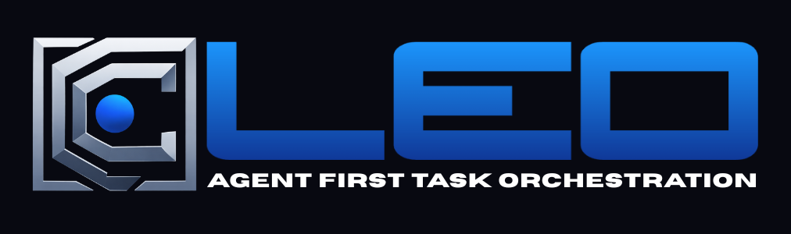

<p align="center">
  
</p>

# CLEO

[](https://www.npmjs.com/package/@cleocode/cleo)
[](https://github.com/kryptobaseddev/cleo/actions/workflows/ci.yml)
[](LICENSE)
[](https://nodejs.org/)

[](https://ko-fi.com/H2H815OTBU)

CLEO is the work, evidence, memory and docs layer for AI coding agents. Agents
(and you) drive it through one CLI, `cleo <command>`, and every call returns a
single JSON envelope on stdout, so any agent harness can read it. CLEO keeps
each change traceable from task to pull request to release, demands evidence
before a task counts as done, remembers what was learned across sessions, and
keeps documentation from rotting.

## What it does

| Area | What you get | Start with |
|---|---|---|
| **Tasks** | Sagas, epics and tasks with acceptance criteria, dependencies and ready waves; sessions that survive interruptions | `cleo add`, `cleo next`, `cleo focus <id>` |
| **Evidence** | A task is done only when its gates are proven: commits and files, CI or test runs, lint and typecheck, linked to each acceptance criterion | `cleo done <id> --plan` |
| **Pull requests** | A PR names its tasks (`Closes: T#### AC1,AC2`); an independent reviewer records a verdict per criterion; merging on green CI closes the task | `cleo done --from-merge <pr> --dry-run`, `cleo review packet` |
| **Docs** | One canonical home per doc, stable names, published mirrors and drift checks (see below) | `cleo docs query`, `cleo docs update` |
| **Memory (BRAIN)** | Observations, decisions and lessons kept across sessions and searchable | `cleo memory observe`, `cleo memory find`, `cleo briefing` |
| **Code intelligence (Nexus)** | A symbol graph of your repo: callers, blast radius, impact before you edit | `cleo nexus analyze`, `cleo nexus impact <symbol>` |
| **Release** | One command tags the newest commit on main with green CI and publishes from changesets | `cleo release cut <version> --dry-run` |

Run `cleo <command> --help` for the full flags of any command.

## Quick start

```bash
npm install -g @cleocode/cleo

cd your-project
cleo init
cleo session start --scope global --name "first session"

# Work is a tree: a saga at the root, epics under it, tasks under those.
cleo saga create --title "Ship the auth hardening" --acceptance "login is rate limited|sessions expire"
cleo add "Auth hardening" --type epic --parent T001 --acceptance "rate limit shipped|session expiry shipped"
cleo add "Rate-limit the login endpoint" --parent T002 \
  --acceptance "returns 429 after 5 failed attempts|a test covers the limit"

cleo next          # what to work on
cleo focus T003    # identity, blockers, docs and memory for one task
```

Then do the work and close it.

- **With a pull request** (the normal path): work on a branch, open a PR whose
  body says `Closes: T003 AC1,AC2`, check it with
  `cleo done --from-merge <pr> --dry-run`, get a per-criterion review
  (`cleo review packet <pr> --task T003`, then `cleo review verdict`), and
  merge on green CI. The merge sweep records the evidence and closes the task.
- **Without a pull request:** `cleo done T003 --plan` names the evidence each
  gate needs; record it with `cleo verify`, then `cleo complete T003`.

Finish with `cleo memory observe "<what you learned>" --title "<short title>"`
and `cleo session end --note "<handoff>"`. The next session starts with
`cleo briefing`.

## Docs that don't rot

AI agents write a lot of documentation, and most of it rots. An agent that
cannot find the existing doc writes a new one; names carry task ids and dates;
two copies drift apart; nobody can tell which one is current. After a few
months the docs folder is a pile of near-duplicates that agents keep extending.

CLEO Docs fixes this at the source:

- **One canonical home per doc.** The store is the source of truth; files in
  `docs/` are published mirrors. Find before you write
  (`cleo docs query "<topic>"`), and update the existing doc
  (`cleo docs update <slug>`) instead of adding a second one. `cleo docs add`
  is for genuinely new docs.
- **Stable names.** Every doc name and slug is lowercase kebab-case with no
  task id, session id or date; task and decision links live in metadata. A CI
  gate (`cleo check canon docs`) refuses new violators.
- **One kind per folder.** `docs/adr`, `docs/spec`, `docs/plan`,
  `docs/research`, `docs/guide`, `docs/concept`, `docs/reference`,
  `docs/migration`, `docs/release` and `docs/note`.
- **Drift is visible.** `cleo docs status` compares each published mirror with
  the store, `cleo docs rot` flags docs whose covered code changed after them,
  and `cleo docs doctor` repairs the store.
- **Messy folders can be migrated.** `cleo docs modernize <folder>` plans a
  kind, a stable name and keep/rename/merge/delete for every file, and applies
  it with a receipt you can roll back.

The how-to is [docs/guide/cleo-documentation-sop.md](docs/guide/cleo-documentation-sop.md).

## Packages

The CLI is `@cleocode/cleo`; it depends on the rest. The main packages:

| Package | Purpose |
|---|---|
| [`@cleocode/cleo`](packages/cleo) | The `cleo` command-line interface |
| [`@cleocode/core`](packages/core) | The SDK: tasks, sessions, evidence, docs, memory, orchestration, release |
| [`@cleocode/contracts`](packages/contracts) | Shared types and operation contracts |
| [`@cleocode/lafs`](packages/lafs) | The JSON envelope format every call returns |
| [`@cleocode/nexus`](packages/nexus) | Code intelligence and the cross-project registry |
| [`@cleocode/caamp`](packages/caamp) | Provider registry and agent package management |
| [`@cleocode/adapters`](packages/adapters) | Provider adapters (Claude Code, Codex, Cursor, Gemini, Kimi, OpenCode and more) |
| [`@cleocode/skills`](packages/skills) | The `ct-*` skills that teach agents how to use CLEO |
| [`@cleocode/cant`](packages/cant) | The CANT agent-definition language |

## Development

Requires Node.js >= 24.16.0 and pnpm.

```bash
git clone https://github.com/kryptobaseddev/cleo.git
cd cleo
pnpm install
pnpm run build
```

Repository rules (package boundaries, architecture gates, evidence) are in
[AGENTS.md](AGENTS.md); see [CONTRIBUTING.md](CONTRIBUTING.md) to contribute.
Every change lands through a pull request that names its tasks; releases are
cut from main with `cleo release cut`.

## The story of CLEO

CLEO began as one developer's refusal to keep losing the thread: powerful
agents that forgot too easily, ambitious projects that died on the shelf.
[The Founding Story](docs/concepts/CLEO-FOUNDING-STORY.md) tells it from the
builder's side, and [The Awakening Story](docs/concepts/CLEO-AWAKENING-STORY.md)
from CLEO's.

## Support

If CLEO helps your workflow, consider supporting development:

[](https://ko-fi.com/H2H815OTBU)

## License

MIT License - see [LICENSE](LICENSE) for details.

## Star History

[](https://star-history.com/#kryptobaseddev/cleo&Date)
