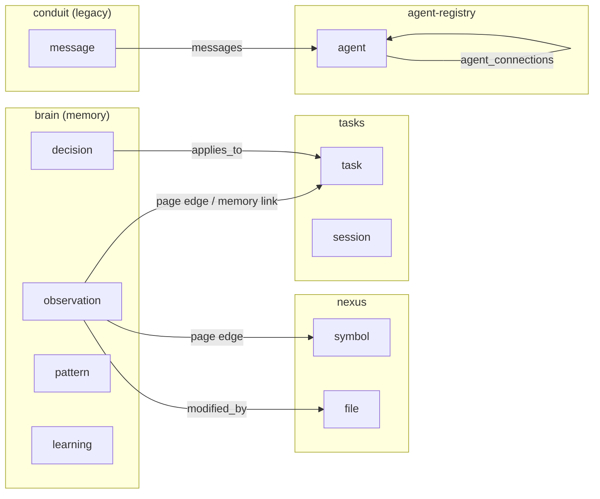

# CLEO Brain Package Specification

**Status**: SPECIFIED
**Package**: `@cleocode/brain` (`packages/brain/`)

> **Companion specs**:
> - [database-architecture.md](database-architecture.md) — the dual-scope `cleo.db` store
> - [cleo-nexus-architecture.md](cleo-nexus-architecture.md) — NEXUS semantics
> - [cleo-conduit-protocol.md](cleo-conduit-protocol.md) — legacy Conduit message semantics
> - [memory-architecture.md](memory-architecture.md) — the memory domain (distinct from this package)
> - [cleo-tasks-api.md](cleo-tasks-api.md) — TASKS semantics
> - [cleo-studio-http.md](cleo-studio-http.md) — Studio HTTP surface
> - `.cleo/agent-outputs/T910-reconciliation/living-brain-architecture.md` — original architecture audit

---

## 1. Summary

`@cleocode/brain` is CLEO's unified-graph package: a read-side projection that
merges **memory + nexus + tasks + conduit + agent registry** into one navigable
graph. It was extracted from the Studio living-brain code into its own
workspace package.

The graph is **computed per request**, not materialized. Each query runs one
adapter per substrate, merges the outputs, prefixes every node ID with its
substrate name, then runs a second-pass stub loader so cross-substrate edges
whose targets fell outside the node budget still resolve. The result is one
`BrainGraph` object (`packages/contracts/src/brain-graph.ts:172`).

### 1.1 Storage status

CLEO's store is one `cleo.db` per scope, opened through `openDualScopeDb`
(`packages/core/src/store/dual-scope-db.ts`):

- **Project** `<project>/.cleo/cleo.db`: `tasks_*` (tasks, sessions, lifecycle,
  provenance, playbooks), project `brain_*` memory, `conduit_*`, `docs_*`, and
  the NEXUS code graph (`nexus_nodes`, `nexus_relations`,
  `packages/core/src/store/schema/cleo-project/nexus-graph.ts`).
- **Global** `<cleoHome>/cleo.db`: the NEXUS project registry (`nexus_project_registry`, …),
  `skills_*`, the agent registry (`agent_registry_*`,
  `packages/core/src/store/schema/cleo-global/agent-registry.ts`), and global
  `brain_*` memory. `cleoHome` is `~/.local/share/cleo` on Linux and
  `~/Library/Application Support/cleo` on macOS; `CLEO_HOME` overrides it.

The separate files `tasks.db`, `brain.db`, `nexus.db`, `conduit.db` and
`signaldock.db` are legacy.

**This package has not moved to `cleo.db` yet.** Its connection getters still
open the legacy per-domain files with per-line `db-open-allowed` markers, and
its adapters query the legacy bare table names (`packages/brain/src/db-connections.ts:20-30`):

| Adapter | File it opens | Tables it queries |
|---|---|---|
| `brain` | `ctx.brainDbPath` (default `<project>/.cleo/brain.db`) | `brain_observations`, `brain_decisions`, `brain_patterns`, `brain_learnings`, `brain_page_edges`, `brain_memory_links` |
| `nexus` | `<cleoHome>/nexus.db` | `nexus_nodes`, `nexus_relations` |
| `tasks` | `ctx.tasksDbPath` (default `<project>/.cleo/tasks.db`) | bare `tasks`, `sessions`, `task_relations`, `task_dependencies` |
| `conduit` | `conduit.db` beside `ctx.brainDbPath` | bare `messages` |
| `agent-registry` | `<cleoHome>/signaldock.db` | bare `agents`, `agent_connections` |

Sources: `packages/brain/src/cleo-home.ts:66-88`, `packages/brain/src/project-context.ts:59-60`,
`packages/brain/src/db-connections.ts:117-239`, and the SQL in each adapter.

Consequences, until the read path is migrated (T14583):

- A getter returns `null`, and its adapter returns no nodes, when the legacy file
  does not exist.
- Studio passes its own `ProjectContext`, whose `brainDbPath` and `tasksDbPath`
  both point at the project `cleo.db` (`packages/studio/src/lib/server/project-context.ts:118-119`).
  The memory adapter's `brain_*` tables exist there under the same names. The
  tasks adapter queries bare legacy names, not the prefixed `tasks_*` tables
  that hold the live data. The conduit, nexus and agent-registry adapters still
  look for their legacy files.
- Messaging now runs on AgentMBX; Conduit is legacy and SignalDock is retired.
  The `conduit` and `agent-registry` substrates only surface data that a legacy
  file still holds.

---

## 2. Terminology

| Term | Definition |
|---|---|
| **substrate** | One of the five sources the graph merges. Runtime names: `brain` (memory), `nexus`, `tasks`, `conduit`, `agent-registry` (`packages/contracts/src/brain-graph.ts:65`). |
| **BrainNode** | One graph vertex. Its ID carries the substrate prefix, so cross-substrate edges reference nodes unambiguously. |
| **BrainEdge** | A directed edge between two nodes. `substrate: 'cross'` marks a bridge between substrates. |
| **bridge** | A cross-substrate edge. |
| **adapter** | A function `(options) => { nodes, edges }` registered in `ADAPTER_MAP` that projects one substrate into the shared schema. |
| **stub node** | A minimal node loaded in the second pass for an edge target outside the budgeted result. Carries `meta.isStub: true`. |
| **per-substrate budget** | Each adapter computes `ceil(limit / 5)`, whatever subset was requested. Default `limit` is 500, so each adapter takes 100. |

The runtime shapes use the `Brain*` names. Wire-format shapes in
`packages/contracts/src/operations/brain.ts` carry a `Wire` suffix
(`BrainNodeWire`, `BrainEdgeWire`, `BrainStreamEventWire`) to avoid colliding
with them.

---

## 3. Authority Chain

```
┌───────────────────────────────────────────────────────────────────────────┐
│ LAYER 1 · CODE SSoT (binding)                                             │
│   packages/contracts/src/brain-graph.ts       ← runtime graph types       │
│   packages/contracts/src/operations/brain.ts  ← wire-format contract      │
│   packages/brain/src/adapters/*.ts            ← substrate adapters        │
│   packages/brain/src/db-connections.ts        ← SQLite getters            │
│                                                                           │
│   RULE: when code and docs disagree, code wins.                           │
└───────────────────────────────────────────────────────────────────────────┘
                              │
                              ▼
┌───────────────────────────────────────────────────────────────────────────┐
│ LAYER 2 · NARRATIVE (this file)                                           │
│   docs/spec/cleo-brain-package.md                                         │
└───────────────────────────────────────────────────────────────────────────┘
                              │
                              ▼
┌───────────────────────────────────────────────────────────────────────────┐
│ LAYER 3 · HTTP SURFACE                                                    │
│   packages/studio/src/routes/api/brain/*                                  │
└───────────────────────────────────────────────────────────────────────────┘
```

Callers MUST cite Layer-1 files when updating this spec. Section 16 lists them.

---

## 4. The Five Substrates

| Substrate | Node ID prefix | Node kinds | Adapter |
|---|---|---|---|
| `brain` (memory) | `brain:` | `observation`, `decision`, `pattern`, `learning` | `packages/brain/src/adapters/brain.ts:167` |
| `nexus` | `nexus:` | `symbol`, `file` | `packages/brain/src/adapters/nexus.ts:46` |
| `tasks` | `tasks:` | `task`, `session` | `packages/brain/src/adapters/tasks.ts:66` |
| `conduit` | `conduit:` | `message` | `packages/brain/src/adapters/conduit.ts:48` |
| `agent-registry` | `agent-registry:` | `agent` | `packages/brain/src/adapters/agent-registry.ts:63` |

The runtime substrate key for memory is `brain`; the wire contract's
`BrainSubstrateName` uses `memory` (`packages/contracts/src/operations/brain.ts:58`).
Callers that translate between the runtime graph and the wire format MUST map
the key.

### 4.1 memory (`brain`)

Typed memory: observations, decisions, patterns, learnings. Node weight comes
from `quality_score`; `minWeight` filters low-weight rows. Intra-memory edges
come from `brain_page_edges`. Bridges:

- `brain_page_edges` whose `to_id` starts with `task:` → `tasks:*` (`brain.ts:343`)
- `brain_page_edges` whose `to_id` looks like a NEXUS ID (contains `::`, or has a `/` and no `:`) → `nexus:*` (`brain.ts:352`)
- `brain_memory_links` rows → `tasks:*` (`brain.ts:387`)
- `brain_observations.files_modified_json` entries → `nexus:*`, edge type `modified_by` (`brain.ts:408`)
- `brain_decisions.context_task_id` → `tasks:*`, edge type `applies_to` (`brain.ts:432`)

### 4.2 nexus

The code symbol and file graph indexed by `@cleocode/nexus`. The adapter
fetches the highest in-degree nodes, capped at the per-substrate budget, and
the relations between them. Node weight is `min(1, in_degree / 50)`
(`nexus.ts:83`). See [cleo-nexus-architecture.md](cleo-nexus-architecture.md).

### 4.3 tasks

Tasks, dependencies and sessions. Tasks take 80% of the per-substrate budget,
ordered by priority, excluding `archived` and `cancelled`; sessions take 20%
(`tasks.ts:94`, `tasks.ts:127`). Intra-tasks edge types:

- `parent_of` — from `parent_id`
- `depends_on` — from `task_dependencies`
- the row's `relation_type` — from `task_relations`

See [cleo-tasks-api.md](cleo-tasks-api.md).

### 4.4 conduit

Agent-to-agent messages from a legacy `conduit.db`. Each message becomes a
node. Aggregated `from_agent_id → to_agent_id` pairs become `messages` bridges
into the agent-registry graph, weight `min(1, pair_count / 10)`
(`conduit.ts:104-113`).

### 4.5 agent-registry

Agent identity from a legacy `signaldock.db`. Agent nodes anchor identity
across substrates. `agent_connections` rows become intra-substrate edges
(`agent-registry.ts:105-128`).

---

## 5. Unified Node/Edge Model

The runtime types live in `packages/contracts/src/brain-graph.ts` and are
re-exported by `packages/brain/src/types.ts`.

### 5.1 BrainNode

```ts
interface BrainNode {
  id: string;                     // substrate-prefixed, e.g. "brain:O-abc", "tasks:T949"
  kind: BrainNodeKind;            // observation | decision | pattern | learning | task | session | symbol | file | agent | message
  substrate: BrainSubstrate;      // brain | nexus | tasks | conduit | agent-registry
  label: string;
  weight?: number;
  createdAt: string | null;       // ISO 8601
  meta: Record<string, unknown>;  // substrate-specific payload
}
```

Source: `packages/contracts/src/brain-graph.ts:43`, `:65`, `:88`.

### 5.2 BrainEdge

```ts
interface BrainEdge {
  source: string;                       // node id
  target: string;                       // node id
  type: string;                         // edge type, e.g. parent_of, modified_by, messages
  weight: number;
  substrate: BrainSubstrate | 'cross';  // 'cross' marks a bridge
}
```

Source: `packages/contracts/src/brain-graph.ts:136`.

### 5.3 BrainGraph

```ts
interface BrainGraph {
  nodes: BrainNode[];
  edges: BrainEdge[];
  counts: {
    nodes: Record<BrainSubstrate, number>;
    edges: Record<BrainSubstrate | 'cross', number>;
  };
  truncated: boolean;
  errors?: Partial<Record<BrainSubstrate, string>>;
}
```

Source: `packages/contracts/src/brain-graph.ts:172`.

`errors` is present only when a read failed. Each key names a substrate whose
nodes or edges may be incomplete; the value is one or more failure messages
joined by `; ` (see §7.4). A substrate absent from `errors` read cleanly, so an
empty substrate there means an empty store, not a broken query.

### 5.4 Node IDs

The prefix before the first `:` names the substrate; the remainder is
substrate-specific and opaque. Examples the adapters emit:

- `tasks:T949`
- `brain:O-mo4abc123`
- `nexus:packages/core/src/store/sqlite-data-accessor.ts::createSqliteDataAccessor`
- `conduit:msg-7f3a2b1c`
- `agent-registry:agent-cleo-prime`

### 5.5 Edge types

`BrainEdge.type` is an open string. Adapters MAY introduce new types without a
schema change. The wire contract enumerates built-ins for autocompletion in
`BrainEdgeKind` (`packages/contracts/src/operations/brain.ts:101`).

---

## 6. Cross-Substrate Bridges

| Bridge | Edge type | Source mechanism | File:line |
|---|---|---|---|
| memory → tasks (page edges) | the row's `edge_type` | `brain_page_edges` with `to_id` starting `task:` | `packages/brain/src/adapters/brain.ts:343` |
| memory → nexus (page edges) | the row's `edge_type` | `brain_page_edges` whose `to_id` is NEXUS-style | `packages/brain/src/adapters/brain.ts:352` |
| memory → tasks (memory links) | the row's `link_type` | `brain_memory_links` rows | `packages/brain/src/adapters/brain.ts:387` |
| memory → nexus (files modified) | `modified_by` | `brain_observations.files_modified_json` | `packages/brain/src/adapters/brain.ts:408` |
| memory → tasks (decision context) | `applies_to` | `brain_decisions.context_task_id` | `packages/brain/src/adapters/brain.ts:432` |
| conduit → agent-registry | `messages` | aggregated `from_agent_id → to_agent_id` counts | `packages/brain/src/adapters/conduit.ts:104` |

Every bridge carries `substrate: 'cross'`.



---

## 7. Adapter Pattern

### 7.1 Signature and registration

```ts
type SubstrateAdapter = (options: BrainQueryOptions) => { nodes: BrainNode[]; edges: BrainEdge[] };

const ALL_SUBSTRATES: BrainSubstrate[] = ['brain', 'nexus', 'tasks', 'conduit', 'agent-registry'];

const ADAPTER_MAP: Record<BrainSubstrate, SubstrateAdapter> = {
  brain: getBrainSubstrate,
  nexus: getNexusSubstrate,
  tasks: getTasksSubstrate,
  conduit: getConduitSubstrate,
  'agent-registry': getAgentRegistrySubstrate,
};
```

Source: `packages/brain/src/adapters/index.ts:33-42`. `BrainQueryOptions`
carries `substrates`, `limit`, `minWeight` and `projectCtx`
(`packages/contracts/src/brain-graph.ts:231`).

### 7.2 Budget

`getAllSubstrates()` passes the overall `limit` (default 500) to each adapter,
and each adapter caps itself at `ceil(limit / 5)`. Within a substrate the
adapter MAY split its budget by kind: the memory adapter spends 40% on
observations, 25% on decisions, 20% on patterns and 15% on learnings
(`brain.ts:194`, `:226`, `:258`, `:287`); the tasks adapter 80% tasks, 20%
sessions.

### 7.3 Merge and stub pass

`getAllSubstrates()` (`index.ts:211`):

1. Runs the requested adapters (default all five) and copies each adapter's
   `error` into `errors[substrate]`, keeping its `failedKinds` (the node kinds
   whose query failed).
2. Deduplicates nodes by ID.
3. Loads stub nodes for edge targets not yet loaded (`index.ts:62`). NEXUS
   stubs are looked up in `nexus_nodes` and typed `file` or `symbol`; stubs for
   other substrates are built without a query and typed `observation`. When the
   caller passed a `substrates` filter, stubs from other substrates are dropped.
   A failed NEXUS stub read is added to `errors.nexus`. A target whose kind is
   one of its substrate's `failedKinds` gets no query-less stub: its edge is
   dropped and counted as `dropped <n> edge(s) whose <kind> target did not
   load because its node query failed` in that substrate's error, one message
   per failed kind. The kind
   comes from the ID: a `tasks:` ID starting `ses_` is a session, any other a
   task; `conduit:` is a message, `agent-registry:` an agent. A missing target
   of a kind that loaded is stubbed as before, even when another query of its
   substrate failed.
4. Sets `truncated` when the node count reaches `limit` and slices to `limit`.

### 7.4 Read failures

A failed read is reported, never returned as a silently empty substrate:

- **Per query.** Each adapter runs every query through `tryQuery`
  (`packages/brain/src/db-connections.ts:152`). A failing query records
  `<table>: <message>` and yields no rows; the adapter's other queries still
  run, so one broken table never hides the rest of the substrate. A query that
  depends on another's rows (task relations on loaded tasks, NEXUS relations
  on loaded nodes) finds nothing to join.
- **Unopenable store.** When the `cleo.db` exists but cannot be opened (a
  restore in progress, a malformed file), the reader reports
  `store cannot be opened: <message>` (`db-connections.ts:95`), and every
  substrate on that store lists it. A missing store is not an error: the
  substrate is empty.
- **Edges to unloaded nodes.** When a memory node query fails, a page edge or
  memory link whose endpoint is of that kind and did not load is dropped, not
  emitted as a dangling edge, and counted as `dropped <n> edge(s) whose <kind>
  endpoint did not load because its node query failed`, one message per kind (`brain.ts:320`).
  An endpoint of a kind that loaded keeps its edge. Node queries run through
  `tryNodeQuery` (`db-connections.ts:172`), which records the failed kind in
  the result's `failedKinds`.
- **Stub pass.** A failed NEXUS stub lookup records
  `nexus_nodes (stubs): <message>` under `errors.nexus`; a message the NEXUS
  adapter already reported is not repeated.

The adapter joins its messages with `; ` into `BrainSubstrateResult.error`,
and `getAllSubstrates()` copies it to `BrainGraph.errors`. Proof:
`packages/brain/src/__tests__/cleo-db-substrates.test.ts`.

---

## 8. Wire Contract

`packages/contracts/src/operations/brain.ts` defines params and results for
eight super-graph operations:

| Op | Purpose | Params | Result |
|---|---|---|---|
| `brain.query` | Unified graph with substrate filter | `BrainQueryParams` | `BrainQueryResult` |
| `brain.node` | One node with its neighbour edges | `BrainNodeParams` | `BrainNodeResult` |
| `brain.substrate` | All nodes/edges for one substrate | `BrainSubstrateParams` | `BrainSubstrateResult` |
| `brain.stream` | Mutation event stream | `BrainStreamParams` | `BrainStreamResult` |
| `brain.bridges` | Cross-substrate edges | `BrainBridgesParams` | `BrainBridgesResult` |
| `brain.neighborhood` | BFS from a seed node | `BrainNeighborhoodParams` | `BrainNeighborhoodResult` |
| `brain.search` | Text search across substrates | `BrainSearchParams` | `BrainSearchResult` |
| `brain.stats` | Per-substrate counters | `BrainStatsParams` | `BrainStatsResult` |

These are wire types only. No dispatch domain implements them and no code
outside the contract file imports the params types; `cleo brain` is a separate
memory-maintenance command group. The live surface is the Studio HTTP routes
in §9, which call `getAllSubstrates()` directly.

The contract's stream union `BrainStreamEventWire` has eight variants:
`hello`, `heartbeat`, `node.create`, `node.update`, `edge.strengthen`,
`edge.create`, `task.status`, `message.send`
(`packages/contracts/src/operations/brain.ts:359`). `BrainStreamParams.sinceTs`
declares a resume cursor (`:400`).

---

## 9. HTTP Endpoints

Studio routes under `packages/studio/src/routes/api/brain/`:

| Endpoint | Behaviour |
|---|---|
| `GET /api/brain` | Unified graph (`+server.ts`) |
| `GET /api/brain/chunks` | NDJSON stream of tier 1 or 2 graph chunks (`chunks/+server.ts`) |
| `GET /api/brain/node/[id]` | One node and its neighbours, from `getAllSubstrates({ limit: 2000 })` (`node/[id]/+server.ts:42`) |
| `GET /api/brain/substrate/[name]` | One substrate's projection (`substrate/[name]/+server.ts`) |
| `GET /api/brain/stream` | Server-Sent Events (`stream/+server.ts`) |

Typed-memory endpoints (observations, decisions, tier stats and the rest) live
under `/api/memory/*`.

### 9.1 Query parameters for `GET /api/brain`

| Param | Default | Semantics |
|---|---|---|
| `tier` | `0` | `0` = up to 200 nodes, `1` = up to 1000, `2` = up to 5000. Drives `limit` when `limit` is omitted. |
| `limit` | tier-driven | Explicit override, clamped to `[1, 5000]`. |
| `substrates` | all | Comma-separated: `brain`, `nexus`, `tasks`, `conduit`, `agent-registry`. Unknown names are dropped. |
| `min_weight` | `0` | Minimum weight threshold. |

Source: `packages/studio/src/routes/api/brain/+server.ts:48-96`. Tier 0
responses are cached in memory for 30 seconds, keyed by project, substrates and
limit; tiers 1 and 2 bypass the cache.

### 9.2 Stream events

`GET /api/brain/stream` emits the runtime `BrainStreamEvent` union
(`packages/contracts/src/brain-graph.ts:286`): `hello`, `heartbeat` (every
30 s), `node.create` (new `brain_observations` row), `edge.strengthen`
(`brain_page_edges` weight change), `task.status`, `message.send`. It polls its
sources every second using per-source watermarks, so delivered rows are not
replayed. It does not implement the contract's `sinceTs` replay.

Consumers SHOULD resolve routes through the Studio HTTP contract
([cleo-studio-http.md](cleo-studio-http.md)) rather than hard-coding paths.

---

## 10. Performance Characteristics

### 10.1 Per-request computation

No graph table exists. Every `getAllSubstrates()` call opens connections, runs
the adapters in sequence, deduplicates, and runs the stub pass.

Connection caching (`packages/brain/src/db-connections.ts`):

- **Global legacy files** (`nexus.db`, `signaldock.db`) are cached at module
  scope; their path is fixed per machine (`:98-142`).
- **Per-project files** (memory, tasks, conduit) are opened fresh per call from
  the caller's `ProjectContext`. Caching across project contexts is the bug the
  Studio counterpart was rewritten to avoid (`:144-239`).

Every open applies the shared pragma set via `applyPerfPragmas`.

### 10.2 Budget guardrails

- `GET /api/brain` clamps `limit` to `[1, 5000]`.
- Each adapter caps itself at `ceil(limit / 5)`.
- The memory adapter splits its share 40/25/20/15 across observations,
  decisions, patterns and learnings.

### 10.3 Tests

`packages/brain/src/__tests__/`:

| Test file | Focus |
|---|---|
| `bridges.test.ts` | Memory-adapter bridge synthesis |
| `stub-loader.test.ts` | Second-pass stub loader, substrate filter contract, `isStub` marker |
| `types.test.ts` | Graph type invariants |
| `created-at-projection.test.ts` | Timestamp normalisation (ISO text vs UNIX epoch) |
| `brain-idempotency.test.ts` | Opening the memory reader twice does not mutate the store |
| `cleo-home-clone-isolation.test.ts` | Two clones of one project resolve their own `.cleo/` |

---

## 11. Relationship to `packages/core/src/memory/`

| Layer | Package | Scope | Contract |
|---|---|---|---|
| **Unified graph** | `@cleocode/brain` | Read-only projection over five substrates | `packages/contracts/src/brain-graph.ts`, `packages/contracts/src/operations/brain.ts` |
| **Memory domain** | `packages/core/src/memory/` | Typed memory, tiers, quality scoring, Hebbian/STDP plasticity, the page graph | `packages/contracts/src/operations/memory.ts` |

The graph reads the memory domain as one substrate (§4.1). The memory domain
owns all writes and lifecycle rules; see [memory-architecture.md](memory-architecture.md).

Graph callers MUST NOT reach into memory-domain internals.

---

## 12. Public API Surface

### 12.1 `@cleocode/brain`

From `packages/brain/src/index.ts`:

```ts
// Substrate adapters and unified query
export {
  getAgentRegistrySubstrate,
  getAllSubstrates,
  getBrainSubstrate,
  getConduitSubstrate,
  getNexusSubstrate,
  getTasksSubstrate,
} from './adapters/index.js';

// Path helpers
export {
  dbExists,
  getAgentRegistryDbPath,
  getBrainDbPath,
  getCleoHome,
  getCleoProjectDir,
  getConduitDbPath,
  getNexusDbPath,
  getTasksDbPath,
} from './cleo-home.js';

// Low-level connection getters
export {
  getAgentRegistryDb,
  getBrainDb,
  getConduitDb,
  getNexusDb,
  getTasksDb,
} from './db-connections.js';

// Project context
export type { ProjectContext } from './project-context.js';
export { resolveDefaultProjectContext } from './project-context.js';

// Graph types (re-exported from @cleocode/contracts)
export type {
  BrainConnectionStatus, BrainEdge, BrainGraph, BrainNode, BrainNodeKind,
  BrainProjectContext, BrainQueryOptions, BrainStreamEvent, BrainSubstrate,
} from './types.js';
```

The path helpers return the legacy file paths listed in §1.1.

### 12.2 `@cleocode/brain/adapters`

The adapter functions, for callers that need one substrate:

```ts
import {
  getAgentRegistrySubstrate,
  getBrainSubstrate,
  getConduitSubstrate,
  getNexusSubstrate,
  getTasksSubstrate,
} from '@cleocode/brain/adapters';
```

### 12.3 `@cleocode/contracts`

The runtime graph types (`BrainNode`, `BrainEdge`, `BrainGraph`,
`BrainQueryOptions`, `BrainStreamEvent`, …) are exported from the
`@cleocode/contracts` root. The wire types (`BrainNodeWire`, `BrainQueryParams`,
`BrainQueryResult`, …) are reachable through the `@cleocode/contracts/operations/brain.js`
subpath or the `ops` namespace export.

---

## 13. Extension Points

### 13.1 Adding a substrate

1. Create `packages/brain/src/adapters/<name>.ts` exporting
   `get<Name>Substrate(options: BrainQueryOptions): { nodes: BrainNode[]; edges: BrainEdge[] }`.
2. Open the source through `openDualScopeDb` (re-exported by
   `packages/brain/src/db-connections.ts:51`). New code MUST NOT add another raw
   open of a legacy file.
3. Add the name to `BrainSubstrate` (`packages/contracts/src/brain-graph.ts:65`)
   and to `BrainSubstrateName` (`packages/contracts/src/operations/brain.ts:58`).
4. Register it in `ALL_SUBSTRATES`, `ADAPTER_MAP` and the stub loader's
   substrate list in `packages/brain/src/adapters/index.ts`.
5. Prefix every node ID with `<name>:`.
6. Emit cross-substrate edges with `substrate: 'cross'`.
7. Add tests under `packages/brain/src/__tests__/`.
8. Revisit the `ceil(limit / 5)` divisor, which is hard-coded in each adapter.

### 13.2 Adding an edge type

1. Choose a stable snake_case identifier matching its neighbours (`applies_to`, `modified_by`).
2. Emit it from the adapter as the edge `type`.
3. Add a test in `packages/brain/src/__tests__/bridges.test.ts`.
4. If it becomes common, add it to `BrainEdgeKind` for tooling support.

### 13.3 Studio rendering

`packages/studio/src/lib/components/LivingBrain3D.svelte` is a thin shim over
`packages/studio/src/lib/graph/renderers/ThreeBrainRenderer.svelte`;
`packages/studio/src/lib/graph/brain-adapter.ts` maps `BrainGraph` into the
renderer's graph types. New node kinds, edge types or stream events need a
mapping there, not in the shim.

---

## 14. Naming

- Runtime types use `Brain*`; the earlier `LB*` names are gone.
- The runtime memory substrate key is `brain`; the wire contract uses `memory`.
- The agent substrate is `agent-registry` in both planes; it was `signaldock`.

---

## 15. Versioning and Publish Lane

- Published to npm as `@cleocode/brain` (public) from the release workflow
  (`.github/workflows/release.yml`, `publish_pkg brain`), versioned with the
  monorepo CalVer.
- Dependencies: `@cleocode/contracts`, `@cleocode/core`, `@cleocode/paths`
  (workspace links), plus `node:sqlite` and `node:fs`.
- Engines: the root `engines.node` floor (`>=24.16.0`).

Releases MUST preserve the exports in §12 unless a breaking change is
coordinated with Studio, the only consumer in the repo.

---

## 16. Non-Goals

- `@cleocode/brain` MUST NOT write store data. Adapters issue `SELECT`
  statements only; the one write on open is the pragma set. The connections are
  not opened with `readOnly`, so this is a code rule, not a driver guarantee.
- It MUST NOT materialize a graph table. Any cache belongs to consumers (Studio
  caches tier-0 responses).
- It MUST NOT replace substrate specifications. Each substrate's rules live in
  its own spec.

---

## 17. References

### 17.1 Code SSoT (Layer 1)

- `packages/contracts/src/brain-graph.ts` — runtime graph types.
- `packages/contracts/src/operations/brain.ts` — wire-format contract.
- `packages/brain/src/types.ts` — re-export of the runtime types.
- `packages/brain/src/adapters/index.ts` — `getAllSubstrates()` and the stub loader.
- `packages/brain/src/adapters/brain.ts` — memory adapter.
- `packages/brain/src/adapters/nexus.ts` — NEXUS adapter.
- `packages/brain/src/adapters/tasks.ts` — TASKS adapter.
- `packages/brain/src/adapters/conduit.ts` — Conduit adapter.
- `packages/brain/src/adapters/agent-registry.ts` — agent-registry adapter.
- `packages/brain/src/db-connections.ts` — SQLite getters and `allTyped<T>`.
- `packages/brain/src/cleo-home.ts` — path helpers.
- `packages/core/src/store/dual-scope-db.ts` — the `cleo.db` chokepoint.

### 17.2 Companion specs

- [database-architecture.md](database-architecture.md) — store layout.
- [cleo-nexus-architecture.md](cleo-nexus-architecture.md) — NEXUS.
- [cleo-conduit-protocol.md](cleo-conduit-protocol.md) — legacy Conduit.
- [memory-architecture.md](memory-architecture.md) — memory domain.
- [cleo-tasks-api.md](cleo-tasks-api.md) — TASKS.
- [cleo-studio-http.md](cleo-studio-http.md) — Studio HTTP surface.
- ADR-098, harness-agnostic core: `cleo docs fetch adr-098-retire-the-pi-cleoos-harness`

### 17.3 Audit and context

- `.cleo/agent-outputs/T910-reconciliation/living-brain-architecture.md` — original architecture audit.
- `.cleo/agent-outputs/T910-reconciliation/brain-memory-reconciliation.md` — naming-collision resolution plan.

---

**End of specification.**
