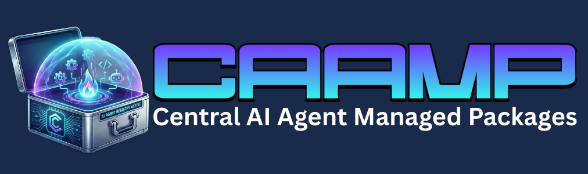

<p align="center">
  
</p>

<p align="center">
  <a href="https://www.npmjs.com/package/@cleocode/caamp"></a>
  <a href="../../LICENSE"></a>
  
  
  
  <a href="https://codluv.gitbook.io/caamp/"></a>
</p>

# CAAMP - Central AI Agent Managed Packages

> Part of [CLEO](https://github.com/kryptobaseddev/cleo#readme). Start with the root README; run `cleo <command> --help` for any command.

**One CLI to manage Skills, MCP servers, and instruction files across 46 AI coding agents.**

CAAMP (`@cleocode/caamp`, bin `caamp`) is the provider registry and package manager for AI coding agents. It replaces the need to manually configure each agent's MCP servers, skills, and instruction files individually, handling the differences in config formats (JSON, JSONC, YAML, TOML), config keys (`mcpServers`, `mcp_servers`, `extensions`, `mcp`, `servers`, `context_servers`, `amp.mcpServers`), and file paths across all supported providers.

CAAMP uses LAFS for agent-facing output: commands print a LAFS JSON envelope by default and human-readable output with `--human`. The protocol lives in `@cleocode/lafs` ([`packages/lafs`](../lafs/lafs.md)).

## Install

```bash
# Global install
npm install -g @cleocode/caamp

# Or run directly with npx
npx @cleocode/caamp <command>
```

After global install, use `caamp` directly:

```bash
caamp providers list
caamp providers detect
caamp mcp install fetch --provider claude-desktop --scope global -- npx -y @modelcontextprotocol/server-fetch
caamp skills install owner/repo
```

## Library Usage

CAAMP also exports a programmatic API:

```bash
npm install @cleocode/caamp
```

```typescript
import {
  getAllProviders,
  getInstalledProviders,
  listAllMcpServers,
  installSkill,
  detectAllProviders,
} from "@cleocode/caamp";

// Get all registered providers
const providers = getAllProviders();

// Detect which agents are installed on this system
const installed = getInstalledProviders();

// List MCP servers for every MCP-capable provider, keyed by provider id
const servers = await listAllMcpServers("global");
```

### Querying Provider Capabilities

```typescript
import {
  getProviderCapabilities,
  getSpawnCapableProviders,
  getProvidersByHookEvent,
  buildSkillsMap,
} from "@cleocode/caamp";

// Get capabilities for a specific provider
const caps = getProviderCapabilities("claude-code");
console.log(caps?.spawn.supportsSubagents); // true
console.log(caps?.hooks.supported); // ["SessionStart", "SessionEnd", ...]

// Find all providers that support spawning subagents
const spawnCapable = getSpawnCapableProviders();

// Find providers supporting a specific hook event
const hookProviders = getProvidersByHookEvent("PostToolUse");

// Get full skills precedence map
const skillsMap = buildSkillsMap();
```

Subpath exports: `@cleocode/caamp/hooks` (hook event normalization and provider mappings) and `@cleocode/caamp/atomic` (locked, atomic config-file writes). See the [API Reference](docs/API-REFERENCE.md) for the full programmatic API.

## CLI Commands

Root options: `-v, --verbose`, `-q, --quiet`, and `--human` (output is JSON for LLM agents by default).

### Providers

```bash
caamp providers list                  # List all supported providers
caamp providers list --tier high      # Filter by priority tier
caamp providers detect                # Auto-detect installed providers
caamp providers detect --project      # Include project-level detection
caamp providers show <id>             # Show provider details
caamp providers skills-map            # Skills path map for all providers
caamp providers hooks                 # Hook support summary (also: hooks matrix, hooks translate <event>)
caamp providers capabilities          # Capability matrix (--filter spawn.supportsSubagents)
```

### Skills

```bash
caamp skills install <source>      # Install from GitHub/URL/marketplace/skill library
caamp skills remove [name]         # Remove skill(s) + provider symlinks
caamp skills list [-g]             # List installed skills
caamp skills find [query]          # Search marketplace (agentskills.in + skills.sh)
caamp skills find [query] --recommend --top 5   # Ranked recommendations
caamp skills init [name]           # Create new SKILL.md template
caamp skills validate [path]       # Validate SKILL.md format
caamp skills audit [path]          # Security scan (44 rules, --sarif for SARIF output)
caamp skills check                 # Check for available updates
caamp skills update                # Update all outdated skills
```

Recommendation criteria flags (`skills find --recommend`):

```bash
--must-have <term>   # required criteria term, repeatable
--prefer <term>      # preferred criteria term, repeatable
--exclude <term>     # excluded criteria term, repeatable
--details            # expanded machine output
--select <indexes>   # pre-select recommendation ranks (comma-separated)
```

### MCP Servers

Every `mcp` verb takes `--scope project|global` (default `project`) and `--project-dir <path>`.

```bash
caamp mcp detect                                              # Providers with MCP config files on disk
caamp mcp list                                                # List servers across every MCP-capable provider
caamp mcp list --provider cursor                              # List for a specific provider
caamp mcp install <name> --provider <id> -- <command> [args]  # Install via inline command
caamp mcp install <name> --provider <id> --from server.json   # Install via JSON file
caamp mcp install <name> --provider <id> --env KEY=VAL -- ... # With env vars
caamp mcp remove <name> --provider <id>                       # Remove from a single provider
caamp mcp remove <name> --all-providers                       # Remove from every MCP-capable provider
```

### Instructions

```bash
caamp instructions inject          # Inject blocks into instruction files
caamp instructions check           # Check injection status across providers
caamp instructions update          # Update all instruction file injections
```

### Config

```bash
caamp config show <provider>          # Show provider config contents
caamp config path <provider> [scope]  # Show config file path (scope: project or global)
caamp doctor                          # Diagnose configuration and health issues
```

### Advanced (LAFS-compliant wrappers)

```bash
caamp advanced providers --min-tier medium --details
caamp advanced batch --skills-file ./skills-batch.json
caamp advanced instructions --content-file ./AGENT-BLOCK.md --scope project
```

### Pi harness verbs (deprecated)

`caamp pi …` (`extensions`, `sessions`, `models`, `prompts`, `themes`, `cant`) still works but prints a deprecation notice first: ADR-098 retires the Pi/CleoOS harness. The `caamp pi` verbs, `core/harness/pi.ts` and the Pi exclusivity mode are deleted after a release has shipped the freeze. The default exclusivity mode is already `legacy` (T13995): CAAMP prefers no harness and targets the installed high-tier providers; `auto` and `force-pi` remain explicit opt-ins (`CAAMP_EXCLUSIVITY_MODE`). Pi stays a normal provider in the registry (medium priority), like any other.

## Common Flags

These are per-command options; run `caamp <command> --help` to see which a command takes.

| Flag | Description |
|------|-------------|
| `-a, --agent <name>` | Target specific agent(s), repeatable |
| `-g, --global` | Use global/user scope (default: project) |
| `-y, --yes` | Skip confirmation prompts |
| `--all` | Target all detected (or all known) agents |
| `--json` / `--human` | JSON envelope (default) or human-readable output |
| `--dry-run` | Preview changes without writing (`instructions inject`) |

## Supported Providers

CAAMP supports **46 AI coding agents** across 3 priority tiers (`packages/caamp/providers/registry.json`):

| Priority | Providers |
|----------|-----------|
| **High** | Claude Code, Cursor, Windsurf |
| **Medium** | Codex CLI, Gemini CLI, GitHub Copilot, OpenCode, Cline, Kimi Coding, VS Code, Zed, Claude Desktop, Amazon Q Developer, GitHub Copilot CLI, Pi Coding Agent, OpenAI SDK (Vercel AI SDK) |
| **Low** | Roo Code, Continue, Goose, Antigravity, Kiro, Amp, Trae, Aide, Pear AI, Void AI, Sourcegraph Cody, Kilo Code, Qwen Code, OpenHands, CodeBuddy, CodeStory, Aider, Tabnine, Augment Code, Devin, Mentat, Blackbox AI, Sourcery, Replit Agent, JetBrains AI Assistant, Codegen, Double, SWE-Agent, Forge, Gemini Code Assist |

### Config Key Mapping

Each provider uses a different key name for MCP server configuration:

| Config Key | Providers |
|------------|-----------|
| `mcpServers` | 38 providers, including Claude Code, Cursor, Windsurf, Gemini CLI, GitHub Copilot, Cline, Kimi Coding and Claude Desktop |
| `mcp_servers` | Codex CLI |
| `extensions` | Goose |
| `mcp` | OpenCode |
| `servers` | VS Code |
| `context_servers` | Zed |
| `amp.mcpServers` | Amp |

Pi Coding Agent and OpenAI SDK have no MCP config.

### Instruction File Mapping

| File | Providers |
|------|-----------|
| `CLAUDE.md` | Claude Code, Claude Desktop |
| `GEMINI.md` | Gemini CLI, Gemini Code Assist |
| `AGENTS.md` | All other providers (Cursor, Windsurf, Codex CLI, Kimi Coding, etc.) |

## Architecture

```
┌─────────────────────────────────────────────────┐
│                   CLI Layer                      │
│  providers │ skills │ mcp │ instructions │ config│
│  doctor │ advanced │ pi (deprecated)             │
├─────────────────────────────────────────────────┤
│                 Core Layer                       │
│  registry │ formats │ skills │ mcp │ hooks       │
│  marketplace │ sources │ instructions │ harness  │
├─────────────────────────────────────────────────┤
│                Data Layer                        │
│  providers/registry.json │ hook-mappings.json   │
│  lock file │ provider configs                    │
└─────────────────────────────────────────────────┘
```

- **Provider Registry**: Single `providers/registry.json` with all provider definitions
- **Hook Mappings**: `providers/hook-mappings.json`, the canonical-to-native hook event SSoT
- **Format Handlers**: JSON, JSONC (comment-preserving), YAML, TOML
- **Skills Model**: Canonical copy + symlinks (install once, link to all agents; copied where a link cannot be made)
- **MCP Writes**: Each provider's registry entry names its config file, format and key, and one format-agnostic writer applies them
- **Lock File**: Tracks installations at `<agents data dir>/.caamp-lock.json`, where the data dir is `$AGENTS_HOME` or the platform default (`~/.local/share/agents` on Linux, `~/Library/Application Support/agents` on macOS)

## Documentation

**[Read the full documentation on GitBook](https://codluv.gitbook.io/caamp/)**. The same guides ship in this package:

| Document | Description |
|----------|-------------|
| [API Reference](docs/API-REFERENCE.md) | Full library API (signatures and examples) |
| [Advanced CLI](docs/ADVANCED-CLI.md) | LAFS-compliant advanced command wrappers and input/output schemas |
| [Advanced Recipes](docs/ADVANCED-RECIPES.md) | TypeScript patterns for tier filtering, rollback, conflict handling, and dual-scope operations |
| [Provider Configuration Guide](docs/PROVIDER-CONFIGURATION.md) | Config keys, formats, scopes, and provider mapping guidance |
| [Migration Guide](docs/MIGRATION-v1.md) | Upgrade notes for moving to v1.0.0 |
| [Troubleshooting](docs/TROUBLESHOOTING.md) | Common failure modes and remediation steps |
| [CLI Help Examples](docs/CLI-HELP-EXAMPLES.md) | `--help` command examples for every command group |
| [Skills Recommendations](docs/SKILLS-RECOMMENDATIONS.md) | Marketplace search and recommendation engine |
| [Contributing](CONTRIBUTING.md) | Development workflow and PR expectations |
| [Security Policy](SECURITY.md) | Private vulnerability disclosure process |
| [LAFS Compliance Profile](docs/LAFS_COMPLIANCE.md) | CAAMP-specific LAFS adoption scope and compliance mapping |
| [Agents Directory Standard](docs/AGENTS-DIRECTORY-STANDARD.md) | `.agents/` standard directory structure |
| [LAFS Specification](../lafs/lafs.md) | Canonical cross-language LLM-agent-first protocol |
| [Technical Specification](claudedocs/specs/CAAMP-SPEC.md) | RFC 2119 spec covering all subsystems |
| [Vision & Architecture](claudedocs/VISION.md) | Project vision, design philosophy, and architecture |
| [Gap Analysis & Roadmap](claudedocs/GAP-ANALYSIS.md) | Current state vs plan, v0.2.0+ roadmap |

## Contributing

Provider definitions live in `providers/registry.json`. To add a new AI coding agent:

1. Add a provider entry to `providers/registry.json` with all required fields
2. Run the package tests (`pnpm --filter @cleocode/caamp test`) to validate the registry
3. Submit a PR

See the [Technical Specification](claudedocs/specs/CAAMP-SPEC.md#3-provider-registry-specification) for the full provider schema.

## License

MIT
